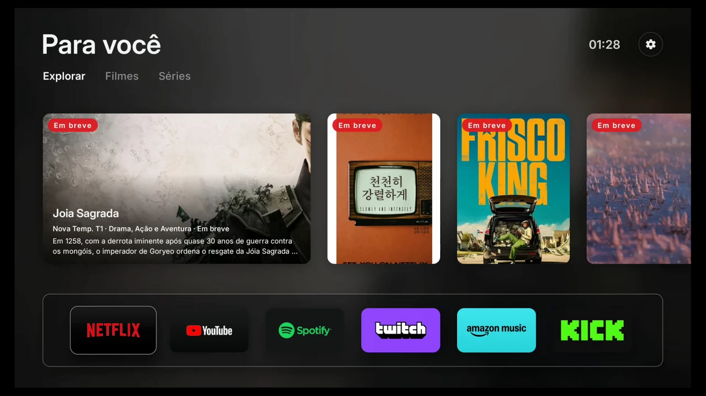

<div align="center">

# 📺 FireTV Minimal Launcher

**Uma tela inicial rápida, limpa e sem anúncios para o seu Fire TV Stick.**

Prateleira de apps estilo tvOS, recomendações do TMDB, screensaver "Dream" e debloat automático.<br>
Código aberto. Baseado no [Free My TV](https://github.com/simbasjungles/free-my-tv). Um comando para reverter tudo.

[O que você ganha](#-o-que-você-ganha) · [Instalação](#-instalação) · [Scripts ADB](#-scripts-adb-por-aparelho) · [Compilar](#-como-compilar-do-zero) · [Créditos](#-créditos)




</div>

---

## ✨ O que você ganha

- **Zero anúncios.** Sem banners patrocinados, sem fileiras promovidas e sem autoplay da Amazon.
- **Seus apps em destaque.** Uma prateleira estilo tvOS com os aplicativos de streaming que você realmente usa, com foco destacado e ícones por marca.
- **Recomendações do TMDB, não anúncios.** Rail de filmes e séries em alta com card principal 16:9 e sinopse, usando sua própria chave gratuita da API do TMDB.
- **Screensaver "Dream".** Fundo com blur suave do card focado, relógio e previsão do tempo.
- **Botão Home sob controle (Home Trap).** Pressionar Home no controle sempre traz você de volta para o seu launcher, sem voltar para a tela poluída da Amazon.
- **Debloat + Rollback em 1 comando.** Desativa pacotes Amazon desnecessários na instalação e permite desfazer tudo a qualquer momento com `--revert`.

---

## 🚀 Instalação

### Pré-requisitos

- **Fire TV Stick** com **Depuração ADB** ativada (*Configurações → Meu Fire TV → Opções do desenvolvedor*).
- **Python 3.10+** e **ADB** instalados no computador.
- O APK compilado em `free-my-tv/FreeMyTV.apk` (veja [Como compilar do zero](#-como-compilar-do-zero)).

### Passo a passo

1. Descubra o IP do seu Fire TV na rede local (ou use `python scripts/dev.py`).
2. Defina o IP do aparelho e rode o instalador:

```bash
# Windows (PowerShell)
$env:FMTV_IP="192.168.1.50"
python scripts/fire_install.py

# Linux / macOS
FMTV_IP=192.168.1.50 python3 scripts/fire_install.py
```

Para reverter tudo e restaurar o launcher original da Amazon:

```bash
python scripts/fire_install.py --revert
```

---

## ⚠️ Scripts ADB (por aparelho)

Os scripts em `scripts/` foram feitos para o meu ambiente e modelo de Fire TV Stick. Antes de executar no seu dispositivo, ajuste:

- **IP / Serial ADB (`FMTV_IP` / `scripts/common_adb.py`):** aponte para o IP do seu Fire TV e confira o caminho do executável `adb`.
- **Lista de pacotes (`scripts/fire_debloat.py`):** cada versão do Fire OS possui pacotes próprios; revise a lista antes de aplicar o debloat.
- **Bloqueio de OTA (opcional):** `scripts/fire_dns_block.py` e `scripts/fire_netguard.py` auxiliam no bloqueio de atualizações automáticas da Amazon.

---

## 🛠️ Como compilar do zero

1. Copie `free-my-tv/config.example.properties` para `free-my-tv/config.properties` e preencha sua chave gratuita da API do TMDB, região e cidade.
2. Gere sua keystore (`free-my-tv/freemytv.keystore`) e execute o build sem Gradle:

```bash
# Windows
python free-my-tv/build_windows.py

# Linux / macOS
bash free-my-tv/build.sh
```

---

## 🙏 Créditos

Baseado e inspirado no projeto **[Free My TV](https://github.com/simbasjungles/free-my-tv)** (`simbasjungles`), adaptado e simplificado especificamente para Fire TV Stick.